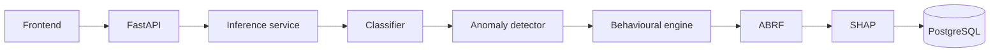

# RiskByte architecture

## Phase 9 product interface

The React/Vite frontend now consumes the frozen FastAPI application through one typed
Zod fetch boundary and TanStack Query hooks. Route modules, domain evidence components,
shared controls, lazy Recharts and CSS tokens preserve the existing app/features/lib/pages
separation. React Hook Form validates analyst inputs; source and outcome metadata never
become caller-controlled model features. The only API extension is bounded read-only
audit history; no scoring engine, artifact, threshold or final metric is modified.

Current activity and canonical final performance remain different populations. The
four explanation layers remain separate; classifier SHAP is not full-system attribution.
Anomaly has zero active fusion influence. Mobile navigation, responsive record tables,
local display preferences and explicit unavailable states are implemented without a
fake login identity or 3D implementation. See [frontend implementation](FRONTEND_IMPLEMENTATION.md)
and [the current API contract](FRONTEND_API_CONTRACT.md).

## Phase 6 extension

`riskbyte_ml.abrf` verifies frozen source/component hashes and consumes only Phase 5's
TRAIN/VALIDATION score sidecar. Its outcome-free input/trace contracts separate scoring
from labelled validation research. A bounded weight/confidence/threshold search compares
fair ablations; immutable run directories contain all candidates, threshold curves, selected
configuration and evidence traces. One exclusive active selection is published after checks.
Six read-only GET endpoints use `ABRFService` to verify and serve JSON reports without model
execution or raw records. Component models/thresholds, frontend and database are unchanged.
See [ABRF research](ABRF_RESEARCH.md), [validation](ABRF_VALIDATION.md) and
[future holdout plan](FINAL_HOLDOUT_PLAN.md). No final inference or SHAP layer exists yet.

## Phase 5 extension

`riskbyte_ml.anomaly.development` verifies opaque source hashes and projects only frozen
TRAIN/VALIDATION records before invoking the unchanged strict-prior builder. No test accessor
exists. Isolation Forest has a dedicated numeric contract, training-reference imputation and
empirical mapping; `riskbyte_ml.behavioural.deviation` is an independent deterministic component
engine with availability/confidence. The frozen Phase 4 Decision Tree is read-only.
Reports and evaluation-only P/A/B sidecars live in ignored `ml/artifacts/phase5/`; no fusion
occurs. Seven GET endpoints serve JSON/checksums through `Phase5Service`, with no fitting,
unpickling or transaction prediction. Frontend and database architecture remain unchanged.
See [anomaly methods](ANOMALY_DETECTION.md), [behaviour](BEHAVIOURAL_DEVIATION.md),
[validation complementarity](PHASE_5_COMPLEMENTARITY.md) and
[fresh final holdout governance](FINAL_HOLDOUT_PLAN.md).

## Phase 4 extension

`riskbyte_ml.models.supervised` owns offline classifier experiments, evaluation, probability
calibration, validation threshold policies and immutable trusted artifacts. It reuses the
frozen feature/preprocessing interfaces. `ModelService` and six versioned GET model-report
routes read a strict JSON registry, verify frozen provenance and never train, unpickle
classifiers or predict transactions in requests. No new database tables, inference service,
anomaly detector, SHAP, ABRF or frontend layout is introduced.

Selection is published before a single selected-model test evaluation; the complete JSON
registry is published atomically after reports. Joblib remains trusted offline serialization.
See [supervised methodology and measurements](SUPERVISED_MODEL_EVALUATION.md).

## Phase 3 extension

`riskbyte_ml.statistics` is an offline analysis layer over the existing synthetic adapter,
frozen temporal split and strictly prior feature builder. It never fits predictive models or
learned preprocessing. Exact source/evaluation hashes, frozen feature version, split hash,
chronological boundaries, row order and target integrity gate execution.

Seven typed `/api/v1/statistics/*` GET routes serve one coherent `analysis_bundle.json`
published atomically after individual reports. API requests recheck exact source hashes and
frozen artifact provenance, rather than relying on mutable filenames or attribute caches.
No calculation, source generation, local path or raw row is exposed through these handlers.
This extends the data intelligence boundary without changing the future inference chain.
See [statistical methods and measured findings](STATISTICAL_ANALYSIS.md).

## Phase 2 extension

An explicit offline synthetic generator writes two ignored tables plus evaluation-only
sidecars. The shared `datasets.two_table` join boundary was extracted from the IEEE adapter
without changing its one-to-one LEFT semantics; IEEE-specific roles/configuration remain
separate. `datasets.synthetic_riskbyte` owns known synthetic schema, provenance and profiling.
`features.behaviour` computes strictly prior context; `evaluation.splits` persists row
partitions; `preprocessing.pipeline` fits training-only transforms and emits CSR matrices.
These modules remain in ML and depend on no HTTP/database lifecycle.

The API supports an explicitly selected `synthetic_riskbyte` adapter and extends existing
integration metadata with typed synthetic provenance, notice, measured join/memory/availability,
feature version and completed fingerprint-matched split strategy. No raw paths or evaluation
row labels are exposed. Default startup remains unconfigured; generation/preprocessing never
runs in an API request. Read-only profiling may still be expensive on first access. The frontend
has a reusable notice constant only; its layout and routes are unchanged. Existing future
inference/classifier/anomaly/ABRF/SHAP/PostgreSQL boundaries remain unimplemented.

## Phase 0 scope

Implemented: monorepo configuration, a minimal React route shell, environment validation,
FastAPI factory and health router, structured errors, request IDs, JSON logging,
SQLAlchemy base/session boundaries, installable ML contracts, and foundation tests.

Planned: inference endpoints, trained models, feature computation, behavioural history,
ABRF aggregation, SHAP computation, business tables/migrations, authentication and
production deployment. The diagram describes the intended complete project, not currently
available runtime behavior.

## Implemented Phase 1 data path

The Phase 0 package boundaries remain intact. `riskbyte_ml.data` contains typed dataset
configuration, conservative inspection, validation, numerical summaries, outlier reporting,
structured EDA, cleaning plans/audits, fingerprinting and an offline CLI. It imports no API
or notebooks and trains no model.

`FastAPI dataset router → DatasetService → riskbyte_ml.data pipeline → typed profile`.
The service lazily caches one source/configuration snapshot per process under a lock and
writes local JSON/Markdown reports. Public profiles omit the local source path. Synchronous
routes use FastAPI's thread pool; source limits bound work. No database/inference lifecycle
is introduced. Versioned `/api/v1/dataset/{status,profile,quality,statistics,eda,schema}`
routes reuse Phase 0 exceptions, logging and request IDs. Unconfigured state is typed;
fatal ingestion errors return structured 422 responses; data-quality failures retain
reviewable data with `dataset_validation_failed`. See [Data pipeline](DATA_PIPELINE.md).

## Phase 1.5 adapter extension

`riskbyte_ml.datasets.ieee_cis` owns all new IEEE-specific roles, left-join rules, catalog,
entity studies and proposed contracts. Generic data code adds explicit categorical roles,
bounded batched string loading and `profile_loaded`; it has no IEEE-specific join logic.
Both adapters share Phase 1 validation/statistics/EDA/report schemas. DatasetService selects
`generic_csv` (default) or `ieee_cis` via validated server configuration and caches both
source signatures. GET `/api/v1/dataset/integration` exposes strict path-free metadata.
Missing sources are lazy dataset errors and never prevent API construction/liveness.
No DB, frontend, ML training or general Phase 2 preprocessing changes.
See [IEEE-CIS integration](IEEE_CIS_INTEGRATION.md) for memory and source availability.

## Intended future inference chain

Frontend → FastAPI → inference service → classifier → anomaly detector → behavioural
engine → ABRF → SHAP → PostgreSQL.

The chain expresses assessment orchestration, not a requirement that one model's output
becomes another model's input. The classifier, anomaly detector and behavioural engine
produce independent signals from shared, versioned preprocessing/features and authorized
historical context. The service combines their outputs through ABRF, requests the
appropriate explanation, and persists a versioned assessment transactionally. PostgreSQL
also supplies historical context through repositories, with an event-time cutoff.

SHAP initially explains the classifier output. It cannot be presented as explaining the
entire fused ABRF score without an experimentally justified composite explanation method.
Explanations return through the inference service and FastAPI to the frontend.

## Module boundaries

| Boundary                  | Responsibility                              | Phase 0 state                   |
| ------------------------- | ------------------------------------------- | ------------------------------- |
| `apps/web/src/app`        | Router composition and application setup    | Minimal routes                  |
| `apps/web/src/config`     | Public environment validation               | Zod startup/build validation    |
| `apps/api/.../routers`    | HTTP contracts, no model logic              | Health only                     |
| `apps/api/.../services`   | Inference orchestration and transactions    | Protocol only                   |
| `apps/api/.../schemas`    | Validated public responses                  | Health/error schemas            |
| `apps/api/.../core`       | Settings, exceptions and logging            | Implemented infrastructure      |
| `apps/api/.../db`         | PostgreSQL engine, sessions, metadata       | Lazy helpers; no tables         |
| `ml/src/riskbyte_ml`      | Offline ML and reusable inference contracts | Import-safe protocols           |
| `ml/data`, `ml/artifacts` | Sensitive data and immutable bundles        | Guidance only; ignored contents |
| `tests`                   | Cross-package foundation verification       | API and ML tests                |
| `infra`                   | Deployment requirements                     | Documentation only              |

## Decisions

1. Use npm workspaces for JavaScript and separate installable Python packages for API/ML.
   Avoid additional orchestration infrastructure before multiple buildable apps need it.
2. Use Python `src/` layouts to enforce package installation and keep ML independent of HTTP.
   Package protocols define dependency direction: API imports ML; ML does not import API.
3. Use strict TypeScript, an `@/` alias configured in both TypeScript and Vite, type-aware
   ESLint, and Tailwind's Vite integration. Keep UI limited to a foundation and 404 page.
4. Validate configuration before serving. Browser configuration is always public.
5. Use a FastAPI factory for independent test settings and startup validation without
   import-time database connections or artifact loading.
6. Select SQLAlchemy with synchronous psycopg sessions for the future PostgreSQL boundary.
   FastAPI synchronous route/service execution can use its thread pool; reconsider async
   persistence only when measured concurrency requirements warrant it.
7. Define `/health` as liveness; future readiness must explicitly check required artifacts
   and dependencies. A healthy Phase 0 API says nothing about scoring availability.
8. No prediction route, identity provider, migration system or deployment exists yet.
   Future inference routes should be versioned (for example `/api/v1`) and authenticated.

## Future artifact and request lifecycle

Train and evaluate offline; promote a signed/checksummed bundle only after acceptance.
Load approved artifacts once in the API lifespan, verify feature schema/dependencies, and
dispose resources on shutdown. Bound inference/explanation time and handle unavailable
components explicitly. Record feature/model/config/explanation versions and request IDs
with assessments. Do not reload mutable model files on each request or train in the API.

CPU-heavy inference may require bounded workers or a separate model service after
profiling. Architecture boundaries permit that move without exposing notebooks or model
internals to clients. PostgreSQL migrations, retention and indexes await finalized schemas.

## Phase 7 explanation boundary

`riskbyte_ml.explainability` verifies frozen Phase 4/5/6 artifacts, reconstructs only the
development prefix and scores only validation. The four distinct layers are underlying
Decision Tree SHAP, deterministic behavioural evidence, diagnostic Isolation Forest
evidence and the exact `abrf.engine.fuse` trace. Calibration remains separate from tree SHAP.
The selected anomaly weight is zero; diagnostic presence never implies fusion influence.

Immutable JSON research snapshots are served by `ExplainabilityService`. HTTP never loads
executable serialization or runs SHAP/model scoring. Transaction lookup is restricted to
precomputed validation cases/errors, without evaluation labels in the unified response.
Frontend and live inference boundaries remain unchanged. Phase 7.1 pins SHAP 0.53.0 and
publishes a frozen SHAP-complete snapshot; historical v1 remains preserved. Missing
dependencies still yield explicit unavailable states rather than fabricated values. See
[explanation contract](RISKBYTE_EXPLANATION_CONTRACT.md).

## Framework references

## Final Phase 8 runtime

The stateful future continuation and one-use evaluator publish FINAL_EVALUATED_LOCKED
artifacts. Final performance is canonical only in FINAL_SYSTEM_RESULTS.md. Historical
research snapshots remain unchanged, including their historical preparation-only status.

FastAPI lifespan initializes one RuntimeService/FrozenSystem per worker, verifies all
frozen components and the locked final holdout, and creates/imports the development
SQLAlchemy store. No model is loaded, fitted or recalibrated by a request. Entity history
combines the fixed 85,000-event checkpoint with earlier persisted observations; SQLite
immediate transactions or PostgreSQL advisory locks serialize prediction commits.
Stored feature vectors support reproducible on-demand SHAP without reading future history.
Prediction records and analyst state are separate; final evaluation artifacts stay immutable.
The React integration surface is documented in FRONTEND_API_CONTRACT.md. No UI is built.

- [Vite setup and runtime requirements](https://vite.dev/guide/)
- [Tailwind Vite integration](https://tailwindcss.com/docs/installation/using-vite)
- [FastAPI settings](https://fastapi.tiangolo.com/advanced/settings/)
- [FastAPI testing](https://fastapi.tiangolo.com/tutorial/testing/)
